# Cinderous Relay (`cinderous-relay`) 產品需求與系統架構規格說明書 (PRD)

> **版本**：v1.0.0-PROD  
> **代號**：Project Beacon Ember (燈塔餘燼)  
> **定位**：以 Nostr 為傳輸、在自己的裝置與小團隊之間做私有、本機優先的同步與協作；中繼一鍵部署到自己的帳號，並預設當成不可信任（[ADR 0064](docs/adr/0064-relay-operator-threat-model-and-bundle-hygiene.md)、[ADR 0065](docs/adr/0065-positioning-private-sync-over-nostr.md)）  
> **核心使命**：為本機優先（Local-First）協同、跨裝置筆記庫同步（CinderSync）與即時無衝突共編（Cinder Coffice）提供永久零主機費、抗廠商鎖定、毫秒級打洞的 WebRTC P2P 去中心化中繼基礎設施。  
> **開源授權**：GNU AGPL-3.0（2026-09-27 由 MIT 改為 AGPL，見 docs/adr/0001）  

> ### ⚖️ 拍板紀錄（2026-09-27，[ADR 0006](docs/adr/0006-prd-contradictions-resolved.md)）——與下文衝突時以此為準
> 1. **relay-lite 持久化**：預設純記憶體（30078／1060 放記憶體＋TTL，重啟即失）；`--persist <路徑>` 改用 SQLite 保存 30 天（沿用 Cinderous `sql-message-store`）。serverless 版一律 DO SQLite。
> 2. **WebRTC 信令**：照 Cinderous——NIP-59 整包，rumor 與外層 wrap 都是 **ephemeral kind 21000**（一次性金鑰簽、只帶收件人 `p`）；後量子公鑰／密文放在包封內。下文的 kind 20078 一律改讀為 21000。
> 3. **Cinder EK**：照 Cinderous ADR-0238／0365——**7 天**輪替、寬限 7 天、kind 10040 公告（`ek-v1`／`ek-pq-v1`）、kind 10042 跨裝置信封 8 槽；格式以 Cinderous `subkey.ts`／`ek-envelope.ts` 為準。
> 4. **後量子混合封裝的古典半邊**：**secp256k1**（與 Nostr 金鑰同一條曲線；照 Cinderous `hybrid-kem.ts`）。下文的 X25519 一律改讀為 secp256k1。
> 5. **kind 分配**：照 Cinderous 的 21000–21999 信令段（21000 檔案／SDP、21002 通話、21003 配對、21004 在線），**協同邀請改用 21005**（原寫 21000 會與信令撞號）。
> 6. **名稱與分塊**：CLI 為 `cinderous relay deploy`；Durable Object 為 `RelayRoom`／binding `RELAY_ROOM`；WebRTC DataChannel 分塊 **16KB**、中繼檔案事件（1060）每塊 **48,000 B** 明文。

---

## 壹、專案總覽與問題診斷 (Executive Summary & Problem Diagnosis)

### 1.1 產品定位與生態願景
`cinderous-relay` 是專為去中心化生產力工具所設計的新世代 Nostr 輕量中繼服務與信令套件。它徹底揚棄傳統 Nostr Relay 為了「儲存推特社群海量歷史推文」所設計的笨重磁碟資料庫架構，轉而專注於**「WebRTC P2P 穿透、後量子雙棘輪握手、以及 CRDT 協同狀態同步之極速信令中繼（Signaling Rendezvous）」**。

本專案與客戶端 SDK（`@cinderous/client`）無縫閉環，共同構成 **Cinderous 全棧開發者生態（Cinderous SDK）**，並作為 **CinderSync**（Obsidian 筆記同步外掛）與 **Cinder Coffice**（Obsidian 多人即時協同工作區）的底層通訊中樞。

```
┌─────────────────────────────────────────────────────────────────────────┐
│                     Cinderous 開發生態系全棧閉環                        │
├────────────────────────────────────┬────────────────────────────────────┤
│     【客戶端 SDK】@cinderous/client │    【中繼端套件】@cinderous/relay   │
├────────────────────────────────────┼────────────────────────────────────┤
│ • WebRTC DataChannel P2P 打洞管線  │ • 三層階梯式信令架構 (3-Tier Transports) │
│ • 後量子混合加密 (ML-KEM + 雙棘輪) │ • 密文只存到保存期限 (TTL／配額)       │
│ • CRDT 狀態同步適配器 (Yjs/Awareness)│ • 嚴格 NIP-42 白名單與存取閘門 (Auth)  │
│ • 向量時鐘檔案差分與串流 Tarball   │ • 一鍵 Cloudflare / Docker 部署 CLI    │
└────────────────────────────────────┴────────────────────────────────────┘
```

---

### 1.2 現存 Nostr 開發生態的三大結構性盲區

在評估全球現有開源方案時，我們診斷出當前 Nostr 生態存在難以彌合的結構性割裂：

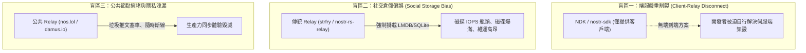

1. **端服嚴重割裂（The Client-Relay Disconnect）**：
   現有的熱門 SDK（如 `rust-nostr`、`NDK`、`nostr-tools`）100% 只負責客戶端。當開發者想做同步或通訊應用時，SDK 只能把問題推給使用者：「請自行找公共 Relay 或去租 Linux VPS 架設伺服器」。
2. **社交倉儲偏誤（Social Warehouse Fallacy）**：
   市面上 95% 的 Relay 都是為了儲存百萬條公開貼文（Kind 1）、用戶資料（Kind 0）與長文（Kind 30023）而寫的「訊息倉庫」。但協同同步應用需要的只是**「撥號兩秒鐘的電話信令」**，強行用社交倉庫中繼打洞，如同「開十八輪大貨車去送一張便條紙」。
3. **強制廠商鎖定風險（Vendor Lock-in Fallacy）**：
   部分無伺服器方案強制將開發者綁死在單一雲端巨頭（如 Cloudflare Workers），違反了密碼龐克（Cypherpunk）的自託管與去中心化精神，並對完全無技術背景的一般小白用戶造成巨大的註冊阻礙。

---

## 貳、三層階梯式信令架構 (Three-Tier Pluggable Signaling Architecture)

為了徹底破解「廠商鎖定」與「高昂進入門檻」的兩難，`cinderous-relay` 確立了**「三層階梯架構（Tiered Architecture）」**：**Cloudflare Workers 絕非唯一或強制預設，而是進階邊緣適配器**。

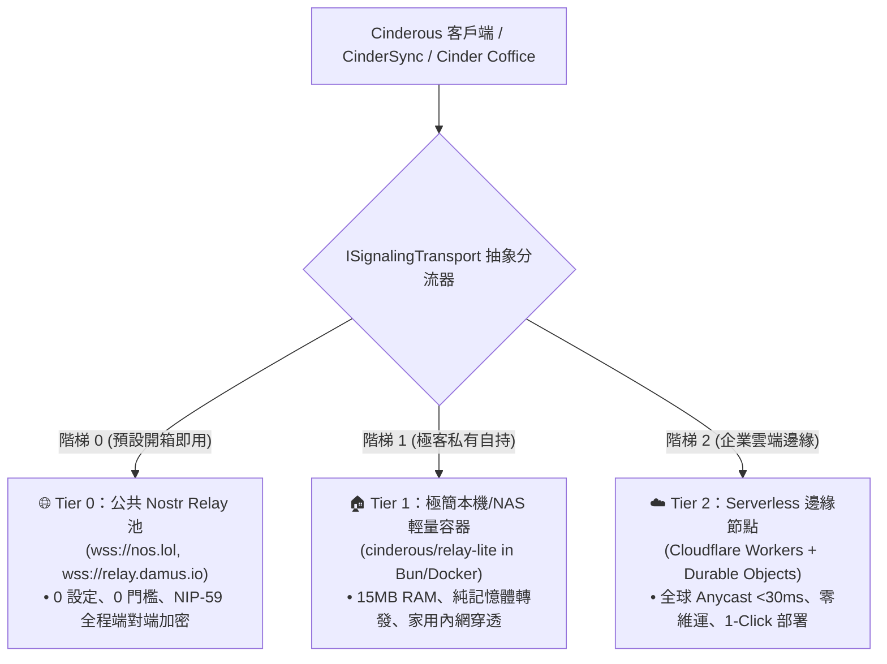

### 2.1 階梯分級規範

| 階梯層級 | 適用對象 | 佈署方式 | 網路延遲 | 維運負擔 | 隱私與隔離性 |
| :--- | :--- | :--- | :--- | :--- | :--- |
| **Tier 0<br>(預設零設定)** | 90% 一般小白用戶<br>下載外掛立即想用者 | **零部署**<br>直接連入預設公共 Relay 池 | 80~250ms<br>(視公共節點負載) | **0 維運** | **高 (端對端加密)**<br>信令經 NIP-59 外覆包裝，公共節點僅見隨機亂碼 |
| **Tier 1<br>(極客本機自託管)** | 具備 NAS、樹莓派、家用伺服器之自託管玩家 | **單行指令**<br>`docker run -d -p 8080:8080 cinderous/relay-lite` | < 10ms (區域網路)<br>20~50ms (外網) | **極低**<br>無資料庫損毀風險，記憶體 <15MB | **極高 (完全自主)**<br>信令不流經任何第三方雲端廠商 |
| **Tier 2<br>(Serverless 邊緣)** | 追求全球最低延遲、不想開 NAS、需要 100% 穩定性的進階團隊 | **一鍵 CLI / 點擊授權**<br>`npx cinderous relay deploy` | **< 30ms (全球 Anycast 邊緣)** | **0 維運 (無伺服器)**<br>享 Cloudflare 免費層每日 10 萬次請求 | **極高 (獨立租戶)**<br>專屬 Worker 子域，內建 NIP-42 白名單 |

---

### 2.2 傳輸層可插拔介面 (`ISignalingTransport`)

核心 SDK 完全解耦於底層傳輸通道，實作標準適配器模式：

```typescript
export interface NostrEnvelope {
  id: string;
  pubkey: string;
  created_at: number;
  kind: number;
  tags: string[][];
  content: string;
  sig: string;
}

export interface NostrFilter {
  ids?: string[];
  authors?: string[];
  kinds?: number[];
  '#p'?: string[];
  '#e'?: string[];
  since?: number;
  until?: number;
  limit?: number;
}

export interface ISignalingTransport {
  readonly tier: 'tier-0-public' | 'tier-1-selfhosted' | 'tier-2-serverless';
  readonly connected: boolean;

  connect(): Promise<void>;
  disconnect(): Promise<void>;
  publish(event: NostrEnvelope): Promise<void>;
  subscribe(filter: NostrFilter, onEvent: (event: NostrEnvelope) => void): () => void;
  authenticate(challenge: string, privateKey: Uint8Array): Promise<boolean>;
}
```

---

### 2.3 對稱型 NAT 穿透防禦與 E2EE WebSocket 雙軌無縫降級規範 (Dual-Track Fallback for Symmetric NAT)

在企業防火牆、大學學術網與 4G/5G 電信級 CGNAT 等極端網路環境下，STUN 打洞因 Port 隨機映射必然失效（失敗率約 15%~20%）。為徹底根絕連線卡死問題，系統規範**「雙軌無縫降級狀態機（Dual-Track Graceful Fallback）」**：

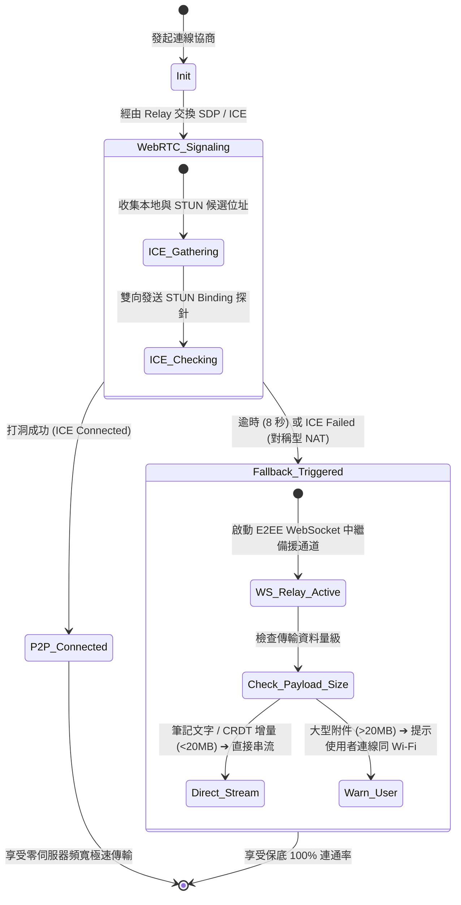

#### 1. 核心參數與工程規格

| 規格維度 | 規範值 | 設計依據與運作邏輯 |
| :--- | :--- | :--- |
| **打洞逾時熔斷閥值** | **8.0 秒 (8000 ms)** | 避免瀏覽器在對稱 NAT 下長達 30 秒的死等；8 秒足以完成正常家用 Wi-Fi 的 ICE 收集，逾時立刻無縫切換。 |
| **備援傳輸協定** | **E2EE WebSocket (Kind 20079)** | 降級走 Relay 轉發，維持純記憶體即發即毀，Relay 僅扮演二進位 Frame 搬運工。 |
| **加密封裝標準** | **ML-KEM-768 ＋ 雙重棘輪** | 即使走中繼伺服器轉發，資料在發送端即已完成後量子雙棘輪加密，**Relay 看不到內容**（IP、時間、大小、收件人 pubkey 等中繼資料仍看得到，見 ADR 0065）。 |
| **串流分塊大小** | **DataChannel 16 KB；中繼檔案事件（1060）每塊 48,000 B 明文**（ADR 0006） | 防止單一巨型 WebSocket Frame 造成瀏覽器渲染執行緒卡頓或記憶體溢位，支援斷點續傳。 |
| **大檔案頻寬防護門檻** | **20 MB (20,971,520 Bytes)** | 傳輸小於 20MB 的檔案/打字編輯完全靜默直傳；大於 20MB 時主動觸發 UI 提示：「*目前處於受限防火牆，已啟用加密中繼模式。傳輸大型附件建議連線至相同區域網路以解鎖 P2P 極速直連。*」 |

#### 2. 傳輸通道雙軌抽象介面 (`IDataChannelTransport`)

```typescript
export type TransportMode = 'p2p-webrtc' | 'relayed-websocket';

export interface IDataChannelTransport {
  readonly mode: TransportMode;
  readonly peerPublicKey: string;
  readonly isEncrypted: boolean; // 永遠保證為 true (ML-KEM + Double Ratchet)

  send(data: Uint8Array): Promise<void>;
  onMessage(callback: (data: Uint8Array) => void): void;
  close(): void;
}
```

---

### 2.4 雙端非同時在線之非同步加密盲信箱與三層資料分流規範 (Asynchronous Encrypted Mailbox & 3-Tier Data Ingestion)

為徹底攻克「辦公室電腦 18:00 關機下班、家用筆電 20:00 開機」等兩端在時空維度從未重疊在線的痛點，系統直接繼承並整合 Cinder 核心實作（`packages/core/src/snapshot.ts`、`sync.ts` 與 `relay/sql-message-store.ts`），建立具備數學確定性收斂的**「非同步加密盲信箱（Asynchronous Encrypted Mailbox）」**與**「三層資料分流防護體系」**。

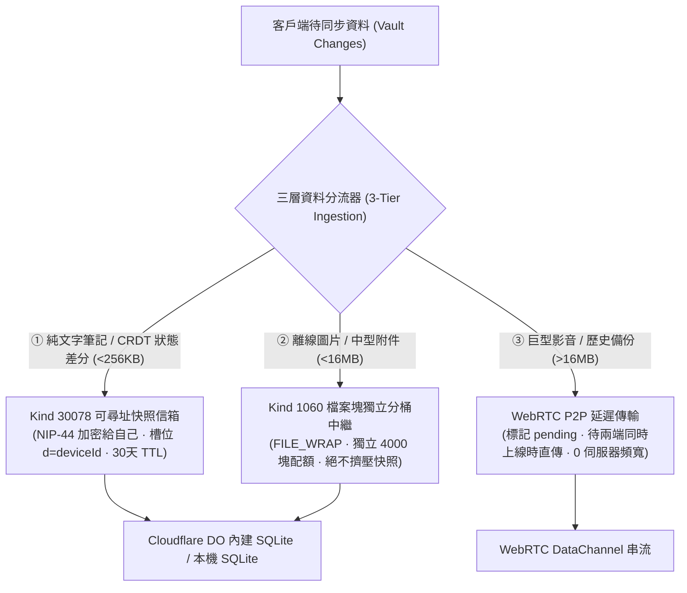

#### 1. 核心參數與工程規格

| 規格維度 | 規範值 | 來源與設計依據（對齊 Cinder ADR-0071 / ADR-0162） |
| :--- | :--- | :--- |
| **快照事件類別 (Kind)** | **`Kind 30078`** | NIP-78 應用程式自訂資料，位於 NIP-33 參數化可尋址（Parameterized Replaceable）範圍。 |
| **裝置獨立槽位 (`d` tag)**| **`d = "<deviceId>"`** | 每台設備擁有獨立儲存槽（如 `d="macbook-work"`、`d="thinkpad-home"`），**不同裝置在 Relay 端永不互踩覆蓋**。 |
| **快照事件壽命 (TTL)** | **30 天 (2,592,000 秒)** | 活躍使用者每次同步自動刷新 TTL；棄用之裝置若超過 30 天無活動，Relay 自動藉由 `prune` 物理回收。 |
| **單顆快照容量硬上限** | **256 KB (262,144 Bytes)** | `ADDRESSABLE_MAX_BYTES`，足以容納純文字 Markdown 筆記差分與向量時鐘狀態；超量附件嚴格排除。 |
| **單一使用者裝置數上限** | **預設 5 台（私有端可設 10~20）** | `ADDRESSABLE_MAX_PER_AUTHOR`，嚴密守護 Cloudflare DO 記憶體（128MB 限制），確保萬人規模不穿透免費層。 |
| **一鍵清空抹除 (Purge)**| **`content: ""`** | 當使用者在設定中關閉備份或解除綁定，送出空字串，Relay 立即物理刪除該記錄（`DELETE FROM addressable`）。 |
| **NIP-01 平手決勝規則** | **新者勝 / `id` 字典序小者勝** | 當兩筆快照時間戳完全一致時，以 event id 字典序較小者為準，保證全球任何節點均確定性收斂至同一份狀態。 |

#### 2. 三層資料分流防護體系（Three-Tier Ingestion Pipeline）

1. **第一層（純文字快照層，Kind 30078）**：
   - 僅收錄 Markdown 文字變更、已讀水位、標籤與向量時鐘狀態。
   - 經由 `buildSnapshotEvent(plaintext, sk, deviceId)` 加密發佈，Relay 僅見密文。
2. **第二層（離線檔案分桶中繼層，Kind 1060）**：
   - 對於 256KB ~ 16MB 的圖片、PDF 附件，切成 $\le 48\text{KB}$ 的二進位塊。
   - 封裝為獨立的 `FILE_WRAP = 1060`，享有獨立的 4000 塊（約 500MB）配額桶，**絕不會把純文字筆記快照擠出資料庫**。
3. **第三層（巨型 P2P 直傳層，WebRTC）**：
   - 超過 16MB 的大型影音或全量備份，客戶端自動標記為 `pending-p2p`。
   - 當兩台裝置檢測到彼此同時上線時，自動透過 WebRTC DataChannel 進行零伺服器頻寬直傳。

#### 3. 客戶端無衝突狀態收斂引擎 (`DeviceSyncState`)

系統直接整合 Cinder 的 `packages/core/src/sync.ts`，多台設備以任意順序拉取異步快照，均能藉由可交換律（Commutative）保證最終一致性：

```typescript
import { DeviceSyncState, type SyncDelta } from '@cinderous/core';

// 當新裝置上線，拉取所有授權裝置的 Kind 30078 快照後執行本地水化
const syncEngine = new DeviceSyncState({
  maxMessages: 100_000,
  maxStateKeys: 10_000
});

// 以交換律依序套用各裝置快照，保證最終狀態收斂一致
for (const remoteSnapshot of fetchedSnapshots) {
  syncEngine.apply(remoteSnapshot.delta);
}
```

---

### 2.5 行動端背景休眠防禦、秒級水化與可選式推播適配器規範 (Mobile Fast Hydration & Pluggable Push Notifications)

行動作業系統（iOS / Android）在使用者鎖定螢幕或切換應用程式後 10~30 秒內會強制凍結背景執行緒並切斷 WebSocket。為兼顧「極客的隱私零洩漏」、「一般用戶的 0 延遲開箱即寫體驗」與「企業團隊的背景通知需求」，系統規範**「秒級水化流水線」**，並將**「集中式推播（APNs / FCM）」設計為完全解耦的可插拔適配器（Pluggable Adapter）**。

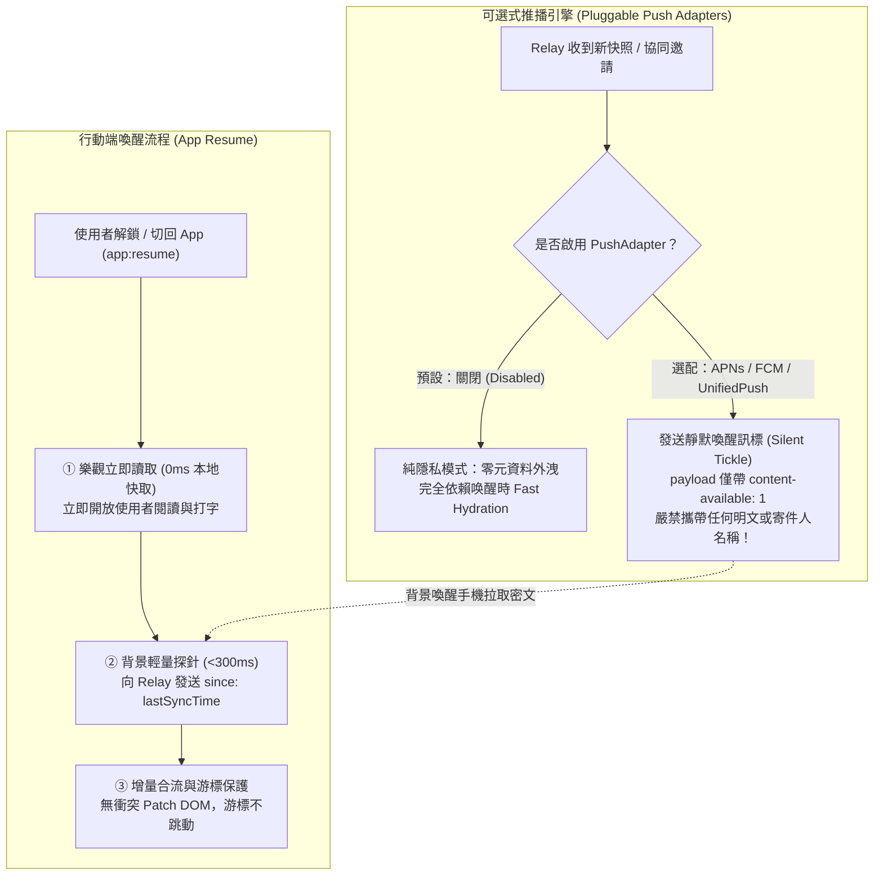

#### 1. 秒級水化流水線四階防護指標

| 防護機制 | 規範值 / 邏輯 | 工程目的 |
| :--- | :--- | :--- |
| **樂觀立即就緒 (Optimistic Ready)** | **0 ms 延遲** | 喚醒瞬間立即載入本地快取資料，解除 UI 凍結，允許用戶立即閱讀與鍵入，絕不等待網路握手。 |
| **輕量時間戳探針 (Timestamp Probe)** | **單次查詢 < 300 ms** | 喚醒時嚴禁掃描磁碟萬筆檔案；只發送 `since: lastSyncTimestamp` 輕量過濾器，傳輸量 $<100\text{ B}$。 |
| **電量與連線守護 (Battery Guard)** | **背景 15 秒主動斷開** | 偵測到 `visibilitychange: hidden` 超過 15 秒，主動關閉 WebSocket 釋放手機晶片電量；喚醒即秒級重連。 |
| **游標不跳動保護 (Cursor Preserving)** | **行級 Diff / Yjs Patch** | 避免水化時全量重新渲染造成游標跳至首行；透過局部文字補丁精準融入編輯器當前編輯流。 |

#### 2. 可配置式推播適配器架構 (`IPushNotificationAdapter`)

在 SDK 中，推播**絕非硬編碼開啟或徹底閹割，而是宣告式插拔選項**：

```typescript
export type PushProviderType = 'disabled' | 'apns' | 'fcm' | 'unifiedpush';

export interface PushNotificationConfig {
  readonly provider: PushProviderType;
  /** 是否開啟純靜默喚醒（不彈出系統横幅，僅背景喚醒同步） */
  readonly silentWakeupOnly: boolean;
  readonly gatewayEndpoint?: string;
  readonly appBundleId?: string;
}

export interface IPushNotificationAdapter {
  readonly provider: PushProviderType;
  registerDevice(token: string): Promise<void>;
  unregisterDevice(): Promise<void>;
  onNotificationReceived(callback: (payload: unknown) => void): void;
}
```

#### 3. 隱私防禦鐵律（Zero-Knowledge Push Guardrail）
若開發者或企業在 SDK 中啟用 APNs 或 FCM：
1. **嚴禁推播明文內容**：發送給 Apple / Google 伺服器的推播內容，**絕對不得包含筆記標題、內文、或任何敏感字樣**。
2. **靜默喚醒訊標（Silent Wake-up Tickle）**：
   - iOS 採用 `{"aps": {"content-available": 1}}`，由 iOS 系統在背景短暫喚醒 App 執行序，直接向 Cinderous Relay 拉取經過 ML-KEM-768 加密的密文並於本機解密，徹底杜絕雲端中間人刺探。
   - 預設模式（`disabled`）則不依賴任何外部推播，由本機「秒級水化協定」保證最佳離線使用體驗。

---

### 2.6 檔案衝突蔓延治理、三向智慧合流與 30 天墓碑垃圾回收規範 (Conflict Sprawl, 3-Way Auto-Merge & Tombstone GC)

為避免本地優先離線同步中常見的「衝突檔案副本氾濫（Conflict Sprawl）」與「已刪除檔案幽靈復活」兩大頑疾，系統整合 Cinder 實作哲學（對齊 `ADR-0224` 墓碑交換律），制定**「三向智慧合流」**、**「視覺化衝突解決器」**與**「30 天墓碑過期垃圾回收（GC）」**三大標準：

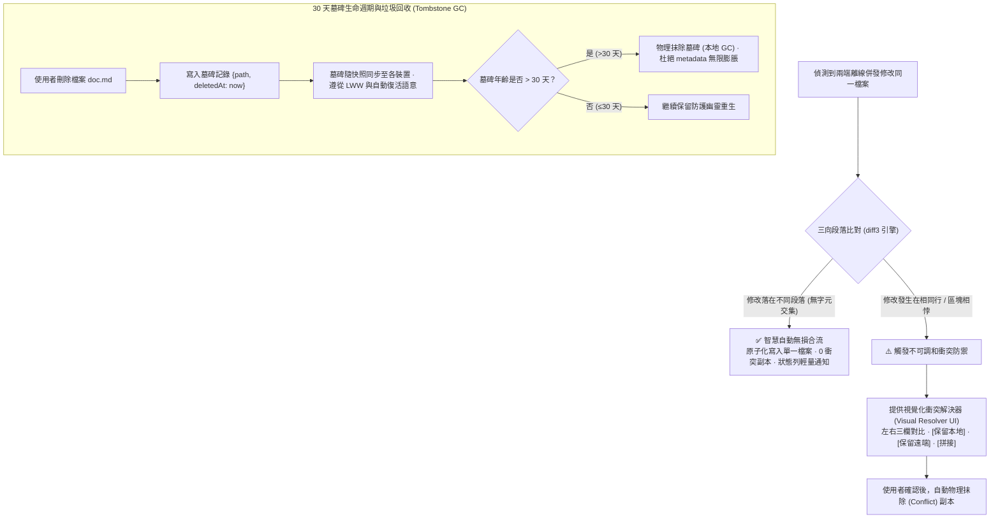

#### 1. 核心參數與工程規格

| 規格維度 | 規範值 | 設計依據與防護邏輯 |
| :--- | :--- | :--- |
| **自動合流演算法** | **輕量級行級 diff3** | 只要兩台裝置編輯的 Markdown 行數/段落無交集，直接靜默合併，**杜絕 80% 無謂的衝突副本產生**。 |
| **衝突副本命名規則** | `[檔名] (衝突-[設備別名]-[時間戳]).md` | 僅在同段落相悖時生成，避免覆蓋任何一方數據，確保數據安全零遺失。 |
| **墓碑保留壽命 (TTL)** | **30 天 (2,592,000 秒)** | 與 Cinder 雲端快照壽命（`SNAPSHOT_TTL_SECONDS = 30 * 86_400`）嚴格對齊，維持全域時間窗口一致性。 |
| **墓碑交換律與復活語意** | **最後寫入者勝 (LWW)** | 比較「檔案最新修改時間」與「墓碑刪除時間」：墓碑較新＝刪除；檔案較新＝**自動復活**（重新建立同名檔案自然生效）。 |
| **沉睡裝置隔離期** | **30 天硬性警戒閥值** | 任何裝置若離線超過 30 天重新聯網，強制進入「沉睡保護隔離（Stale Quarantine）」，需用戶確認後方可合併，防止遠古刪除檔案被舊機意外復活。 |

#### 2. 視覺化衝突解決器 UI 規範 (Conflict Resolver Modal)

外掛與桌面端必須實作統一的衝突解決視窗：
1. **並排對比面板**：左側呈現本地版本（Local Version）、右側呈現遠端版本（Remote Version）、底部呈現即時合流預覽（Merged Preview）。
2. **快捷解決動作組**：
   - `[採用本地版本]`：保留當前裝置內容，遠端標記為過期。
   - `[採用遠端版本]`：以遠端內容覆蓋本地。
   - `[雙版本合併拼接]`：在衝突區塊前後自動插入標記並保留兩者全文供後續編輯。
3. **自動清理（Auto-Purge Fork）**：確認解決方案並寫入主檔案後，系統**自動刪除對應的 `(衝突-*)` 暫態檔案**，恢復知識庫乾淨結構。

---

## 參、瞬時事件引擎與端對端加密通訊協定 (Ephemeral Engine & E2EE Protocol)

### 3.1 瞬時事件生命週期（Ephemeral Event Lifecycle）

傳統 Relay 對每個事件都會觸發磁碟寫入（Disk Write Transaction）。`cinderous-relay` 對**信令事件（ephemeral kind）**採取「純記憶體路由、撮合後即丟棄」。**離線訊息與檔案塊（1059／1060）、覆蓋型資料（30078）則以密文保存到保存期限**：Cloudflare 版存在 Durable Object 的 SQLite；relay-lite 預設放記憶體，`--persist` 才用 SQLite（ADR 0006、ADR 0065）：

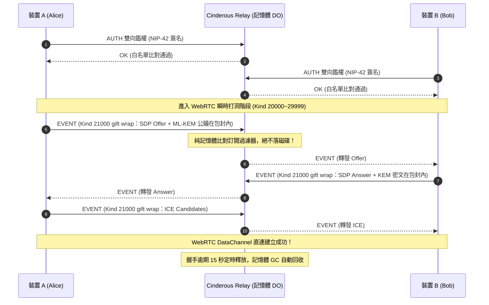

1. **事件類型隔離（Kind Separation）**：
   - **`Kind 20000 ~ 29999`（NIP-16 Ephemeral 瞬時事件）**：
     專門用於 WebRTC SDP Offer/Answer、ICE Candidate 與在線探針。Relay 收到後只在記憶體內查找活躍訂閱者（Active Subscriptions），廣播後立即丟棄，**磁碟寫入量為精確的 0 Bytes**。
   - **`Kind 30078`（NIP-78 覆蓋型應用資料，僅在 Tier 2 選用）**：
     僅在需要儲存裝置公鑰名冊或同步錨點時啟用，由 Durable Objects 內建 SQLite 保存**「最新一筆」**覆蓋值，絕不累積歷史封包。
2. **NIP-40 自動失效機制（Expiration Support）**：
   即使客戶端發送帶有儲存需求的事件，若包含 `["expiration", "<timestamp>"]` 標籤，Relay 會在記憶體快取中設定 TTL 計時器，逾期自動清理。

---

### 3.2 後量子混合加密封裝（PQ-Hybrid Encapsulation）

所有流經 Relay 的信令封包必須在客戶端完成雙層防禦加密，Relay **看不到任何協同內容**，即使 Relay 節點被惡意第三方取得也一樣。但加密藏的是內容、不是中繼資料：Relay 仍看得到連線 IP、時間、封包大小與外層的收件人 pubkey（ADR 0064、ADR 0065）：

```
┌────────────────────────────────────────────────────────────────────────┐
│              Cinderous 信令封包結構 (NIP-59 + PQ-Hybrid)               │
├────────────────────────────────────────────────────────────────────────┤
│ [最外層：NIP-59 Gift Wrap]                                             │
│   • Kind: 1059 (密封禮物包)                                             │
│   • Pubkey: 隨機一次性拋棄式公鑰 (Ephemeral Pubkey)                    │
│   • Tag: ["p", "<Recipient_Nostr_Pubkey>"]                            │
│   ┌──────────────────────────────────────────────────────────────────┐ │
│   │ [中間層：後量子混合密鑰 (Hybrid KEM)]                             │ │
│   │   • ML-KEM-768 封裝密文 (Kyber) ＋ secp256k1 ECDH 共用密鑰       │ │
│   │   • 抵禦未來量子電腦「先攔截、後解密（Harvest Now, Decrypt Later）」│ │
│   │   ┌────────────────────────────────────────────────────────────┐ │ │
│   │   │ [最內層：雙重棘輪有效載荷 (Double Ratchet Payload)]       │ │ │
│   │   │   • WebRTC SDP Offer / Answer (含 H.264 / Opus / Data)     │ │ │
│   │   │   • ICE 候選傳輸地址 (STUN/TURN Candidates)                │ │ │
│   │   │   • CRDT 房間連線識別碼 (Session Token)                    │ │ │
│   │   └────────────────────────────────────────────────────────────┘ │ │
│   └──────────────────────────────────────────────────────────────────┘ │
└────────────────────────────────────────────────────────────────────────┘
```

---

### 3.3 安全防禦與訪問控制（Access Control & Anti-Abuse）

1. **NIP-42 強制雙向鑑權**：
   - 當客戶端發起 WebSocket 連線時，Relay 發送：
     `["AUTH", "<random_challenge_nonce>"]`
   - 客戶端必須在 5 秒內回應以私鑰簽名的 Event：
     `["EVENT", { "kind": 22242, "tags": [["relay", "..."], ["challenge", "..."]] }]`
2. **白名單防禦門禁（Whitelist Gatekeeper）**：
   - Relay 環境變數配置 `ALLOWED_PUBKEYS`（支援金鑰清單或主控者簽署的憑證授權）。
   - **不在白名單中的連線，在鑑權失敗後立刻被主動斷開（WebSocket Close 4003）**，完全杜絕外部機器人發送垃圾訊息消耗伺服器記憶體。
3. **滑動視窗限流（Rate Limiting）**：
   - 單一 IP 限制每秒最多 20 次訊息發送。
   - 單一公鑰限制並發 WebSocket 連線數 $\le 5$。

---

### 3.4 後量子金鑰防偽綁定證明與抗降級防禦規範 (Post-Quantum Key Binding Proof & Anti-Downgrade Protocol)

為防範惡意中繼站進行「中間人攻擊（MITM）」暗中替換 1,184 位元組的 ML-KEM-768 公鑰，系統利用 Nostr 原生 BIP-340 Schnorr 密碼學架構，規範**「強型別身分綁定證明（Cryptographic Key Binding Proof）」**與**「抗降級電路熔斷（Anti-Downgrade Circuit Breaker）」**：

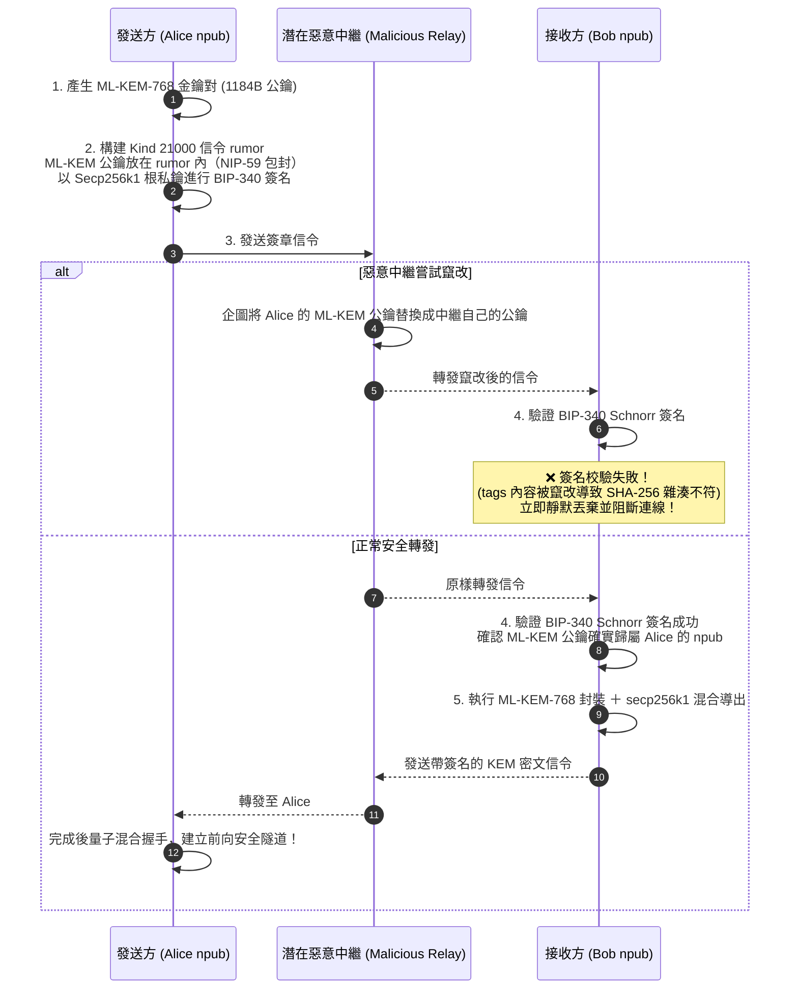

#### 1. 密碼學強型別標籤契約（Cryptographic Tag Invariant）

任何攜帶後量子密鑰交換的信令事件（Kind 21000 打洞信令〔NIP-59 包封，以下 tags 位於 rumor 內〕、Kind 21005 協同邀請〔原寫 21000，與信令撞號；ADR 0006〕、Kind 10040 金鑰公告），必須遵循嚴格的 Tags 結構：

```json
{
  "kind": 21000,
  "pubkey": "<Alice_Secp256k1_Hex_Pubkey>",
  "created_at": 1726912345,
  "tags": [
    ["p", "<Bob_Secp256k1_Hex_Pubkey>"],
    ["ml_kem_pubkey", "<1184_Bytes_Base64_Encoded_ML_KEM_Public_Key>"],
    ["kem_algo", "cinder-ek-pq-v1"],
    ["challenge", "<32_Bytes_Random_Nonce>"]
  ],
  "content": "<NIP-44_or_PQ_Encrypted_SDP_Payload>",
  "sig": "<BIP-340_Schnorr_Signature_Covering_All_Tags>"
}
```

- **物理不可篡改性**：Nostr 事件 ID 為 `SHA-256([0, pubkey, created_at, kind, tags, content])`，簽名覆蓋整個事件雜湊。中繼站若修改 `ml_kem_pubkey` 的任何 1 個位元組，**事件簽章立即碎裂**，接收端必在解密前拒絕連線。
- **重放防護（Replay Protection）**：強制要求在 tags 內攜帶 `challenge` 隨機亂數與小於 15 分鐘的時間戳窗（對齊 Cinder ADR-0235）。

#### 2. 抗降級熔斷機制（Anti-Downgrade Circuit Breaker）

- **雙端能力宣告（Capability Assertion）**：客戶端在首次握手時宣告支援 `kem_algo: "cinder-ek-pq-v1"`。
- **防降級鐵律**：若通訊任一方已知對端曾宣稱支援後量子混合算法，**通訊狀態機嚴禁退回古典純 ECDH（NIP-04 或未經 KEM 的 NIP-44）**。
- **異常阻斷**：若握手過程中發現量子標籤被惡意中繼站剝除，客戶端立刻拋出 `SecurityDowngradeAttackDetectedError`，主動中斷連線並彈窗警示使用者「可能遭遇通訊降級中間人攻擊」。

---

### 3.5 雙密碼引擎取捨架構：雙棘輪 (Double Ratchet) vs Cinder EK (Ephemeral Key) 互補規範 (Dual Crypto Engines: Double Ratchet vs Cinder EK Trade-off)

在現代應用密碼學與分散式協同系統中，不存在放之四海皆準的單一加密協議。為兼顧「多裝置非同步離線快照的強韌度」與「即時端對端協同的極致隱私安全性」，`Cinderous SDK`（`@cinderous/client`）確立**雙密碼引擎抽象架構（Dual Pluggable Crypto Engines）**，將 **Cinder EK 暫態金鑰封裝模式** 與 **Signal 雙棘輪演算法（Double Ratchet）模式** 整合於統一的介面之下，使開發者與應用程式可根據業務場景宣告式取捨或動態協商。

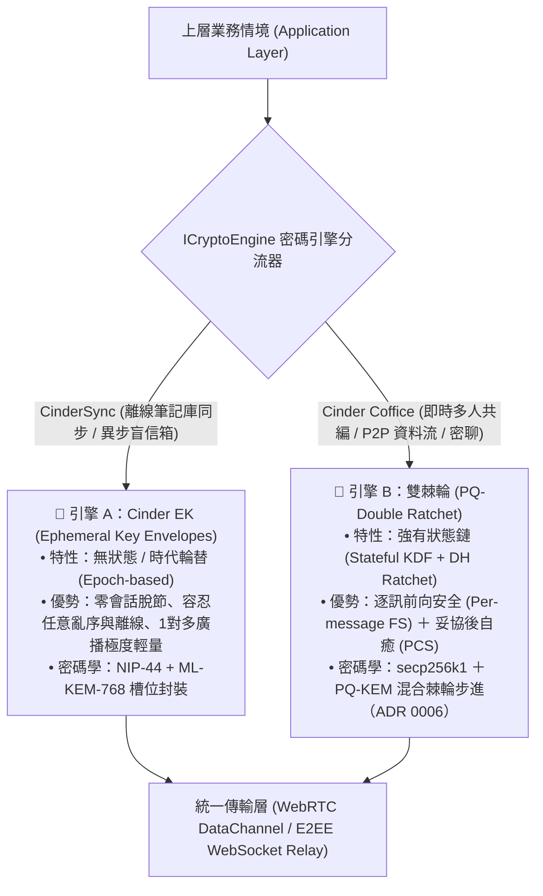

#### 1. 雙密碼引擎深度技術指標對照矩陣

下表詳盡評估兩大加密架構在數學特性、系統開銷與業務場景下的硬核權衡：

| 評估維度 | 引擎 A：Cinder EK 暫態金鑰模式 (`cinder-ek`) | 引擎 B：雙棘輪演算法模式 (`double-ratchet`) | 架構取捨裁決 (Architectural Verdict) |
| :--- | :--- | :--- | :--- |
| **底層理論原型** | Cinder 混合 KEM 封裝 (`ADR-0071` / `ADR-0162`) | Signal Protocol 雙棘輪規範 (WhisperSystems) | 各取所長：靜態異步取 EK，動態流式取棘輪。 |
| **會話狀態性 (Statefulness)** | **無狀態 / 週期性時代 (Stateless / Epoch-based)**<br>金鑰依固定週期（**7 天**，照 Cinderous ADR-0238；ADR 0006）輪替。 | **嚴格有狀態鏈 (Strictly Stateful)**<br>每個訊息來回皆推進對稱金鑰鏈與非對稱 DH 步進。 | 離線異步情境嚴禁使用雙棘輪，避免狀態機脫節。 |
| **前向安全 (FS) 粒度** | **週期 / 快照級前向安全 (Epoch-level FS)**<br>金鑰定時輪替，歷史快照無法藉由舊密鑰解開。 | **逐則訊息前向安全 (Per-message FS)**<br>每一則發出的訊息金鑰使用一次即銷毀，絕對不可逆。 | 即時即時通訊與共編需極致 FS，由雙棘輪主導。 |
| **後洩露安全 (PCS / 自癒)** | **弱（需等待下一輪 Epoch 金鑰輪替）**<br>若當期 EK 洩漏，需等待新快照產生或手動 Revoke。 | **極強（破局自癒 Break-in Recovery）**<br>只要未被監控的端點產生新 DH 步進，立即自癒恢復安全。 | 協同工作區（Coffice）長時間保持連線時，PCS 至關重要。 |
| **封包亂序與丟失容忍度** | **100% 容忍任意亂序與丟包**<br>每筆快照自包含解密標頭，無順序依賴性。 | **需滑動視窗緩衝 (Bounded Skipped Keys)**<br>封包遺失超逾緩衝上限（如 2000 則）將導致會話死鎖損毀。 | 巨量批次同步取 EK；高頻有序串流取雙棘輪。 |
| **多裝置廣播扇出 (Fan-out)** | **$O(1)$ 負載 ＋ $O(N)$ 槽位包裝 (Lightweight)**<br>單一密文負載，僅在標頭為各授權裝置封裝 Key Slot。 | **$O(N)$ 雙向配對狀態維護 (Combinatorial Explosion)**<br>每對裝置需獨立維護一組雙棘輪會話，狀態管理昂貴。 | 跨 5~10 台個人裝置的同步庫首選 Cinder EK。 |
| **初始連線握手開銷** | **零來回 (0-RTT)**<br>直接讀取接收方已發佈之公鑰/EK 即完成單向加密寫入。 | **需先期握手或預共享密鑰束 (X3DH / 1-RTT)**<br>需先交換 Ephemeral DH 金鑰方能啟動首輪棘輪。 | 異步盲信箱 0-RTT 寫入首選 Cinder EK。 |
| **典型業務主導場景** | **CinderSync 筆記庫同步、非同步盲信箱、離線備份** | **Cinder Coffice 即時共編、WebRTC 音視訊、1:1 機密對話** | SDK 預設提供場景自動預設集，同時開放完全手動設定。 |

#### 2. 統一抽象介面架構 (`ICryptoEngine`)

在 `@cinderous/client` 中，核心密碼模組完全透過介面解耦，杜絕上層業務邏輯與底層加密細節耦合：

```typescript
export type CryptoEngineType = 'cinder-ek' | 'double-ratchet';

export interface CryptoEngineConfig {
  /** 選擇底層密碼引擎 */
  readonly engine: CryptoEngineType;
  /** 是否強制啟用後量子混合防禦 (ML-KEM-768) */
  readonly postQuantumEnabled: boolean;
  /** 雙棘輪專屬：最大允許跳過/亂序之訊息金鑰數量 (預設 2,000) */
  readonly maxSkippedKeys?: number;
  /** Cinder EK 專屬：暫態金鑰輪替週期秒數 (預設 604,800 秒 / 7 天；ADR 0006) */
  readonly ekRotationIntervalSeconds?: number;
}

export interface EncryptedEnvelope {
  readonly engineType: CryptoEngineType;
  readonly kemAlgorithm?: 'cinder-ek-pq-v1' | 'pq-double-ratchet-v1';
  readonly header: Uint8Array; // 包含 DH 公鑰、輪次計數器或 EK Slot 槽位標頭
  readonly ciphertext: Uint8Array;
}

export interface ICryptoSession {
  readonly engineType: CryptoEngineType;
  readonly peerPublicKey: string;

  /** 加密二進位資料載荷 */
  encrypt(plaintext: Uint8Array): Promise<EncryptedEnvelope>;

  /** 解密傳入之封裝信封 */
  decrypt(envelope: EncryptedEnvelope): Promise<Uint8Array>;

  /** 序列化導出當前會話狀態 (供本機加密持久化保存) */
  exportState(): Promise<Uint8Array>;

  /** 銷毀會話並物理擦除記憶體中之私鑰與鏈金鑰 */
  destroy(): void;
}

export interface ICryptoEngine {
  readonly type: CryptoEngineType;

  /** 初始化或恢復與特定端點之密碼會話 */
  createSession(
    peerPublicKey: string,
    initialState?: Uint8Array,
    options?: CryptoEngineConfig
  ): Promise<ICryptoSession>;

  /** 單向單封裝加密（適用於非同步盲信箱廣播，僅 Cinder EK 支援） */
  sealForRecipients?(
    plaintext: Uint8Array,
    recipientPubkeys: string[]
  ): Promise<EncryptedEnvelope>;
}
```

#### 3. 場景自適應動態路由策略 (Scenario-Driven Presets & Dynamic Routing)

SDK 為開發者提供三種開箱即用的策略模式：

1. **`Preset: 'vault-sync'`（預設用於 CinderSync）**：
   - 綁定 `engine: 'cinder-ek'`。
   - 啟動非同步多槽位封裝，完美契合 Kind 30078 快照與 Kind 1060 分桶檔案。
   - 裝置離線 30 天後開機拉取，完全不會發生棘輪失步或金鑰過期損毀。
2. **`Preset: 'live-collaboration'`（預設用於 Cinder Coffice）**：
   - 綁定 `engine: 'double-ratchet'`。
   - 在 WebRTC DataChannel 建立成功後立即啟動對稱＋DH 棘輪。
   - 協同過程中的每一次 Yjs Update、打字游標跳動或訊息，皆享有逐訊前向安全（Per-message FS）。
3. **`Preset: 'auto-negotiate'`（自適應能力協商）**：
   - 雙端握手時檢查對端宣告能力（Nostr Tags `crypto_engines: ["cinder-ek", "double-ratchet"]`）。
   - 若雙端同時在線且皆支援雙棘輪，自動升級為最高等級之雙棘輪會話；若偵測為單向離線投遞或多端備份，則無縫切換為 Cinder EK 模式。

#### 4. 後量子混合強化在雙引擎中的統一落地

- **Cinder EK 模式的 PQ 落地**：如 §3.2 與 §3.4 所示，以 secp256k1 ＋ ML-KEM-768 雙重金鑰推導出對稱加密金鑰（照 Cinderous `hybrid-kem.ts`，ADR 0006）。
- **Double Ratchet 模式的 PQ 落地（PQ-Double Ratchet）**：
  - 在傳統雙棘輪每次進行 DH 棘輪步進（DH Ratchet Step）更換 secp256k1 金鑰對時，同步附帶發送 ML-KEM-768 公鑰。
  - 對端在回覆時附帶 KEM 封裝密文。
  - 根金鑰推導函數更新為：  
    $$\text{RootKey}_{i+1} = \text{HKDF}\big(\text{RootKey}_i, \text{DH\_Secret} \parallel \text{KEM\_SharedSecret}\big)$$
  - 目的：雙棘輪除了古典的自癒，也防「今天側錄、將來用量子電腦解密」（Harvest Now, Decrypt Later）。只保護加密，簽章仍是 secp256k1，不是「量子安全」（ADR 0010、0065）。

---

## 肆、橫向技術基準評估與競品對照矩陣 (Benchmark & Competitive Matrix)

### 4.1 核心指標對比矩陣

將 `cinderous-relay` 與現存主流 Nostr Relay 實作全面對照：

| 評估維度 | `strfry` | `nostr-rs-relay` | `khatru` | `nostream` | **`cinderous-relay`** |
| :--- | :--- | :--- | :--- | :--- | :--- |
| **開發語言** | C++20 | Rust | Go | TypeScript / Node | **TypeScript (Workers / Bun)** |
| **架構類型** | 單機常駐 Daemon | 單機常駐 Daemon | 函式庫/微服務 | 分散式容器叢集 | **Serverless 邊緣 ＋ 輕量本機雙模** |
| **持久化引擎** | LMDB (記憶體映射) | SQLite / Postgres | 可自訂 (Badger/PG) | Redis + PostgreSQL | **純記憶體轉發 (DO / RAM)** |
| **閒置記憶體** | ~100MB | ~50MB | ~30MB | 300MB ~ 1GB | **< 15MB (Docker) / 0MB (Workers)** |
| **冷啟動延遲** | 需常態開機 | 需常態開機 | 需常態開機 | 需常態開機 | **0 ms (Edge Serverless)** |
| **部署複雜度** | 極高 (需編譯 C++) | 中 (需 Docker) | 中 (需寫 Go 主程式)| 高 (需 DB 與 Redis)| **極低 (1-Click CLI / 單一命令)** |
| **全球網路延遲**| 取決於單一機房 | 取決於單一機房 | 取決於單一機房 | 取決於單一機房 | **< 30ms (全球 300+ Anycast)** |
| **硬碟寫入損耗**| 巨量 (隨貼文累增)| 巨量 | 中~高 | 巨量 | **0 損耗 (信令不落碟)** |
| **WebRTC 最佳化**| ❌ 無 | ❌ 無 | ❌ 無 | ❌ 無 | **✅ 原生瞬時撮合管道** |
| **維運月費** | $5 ~ $20/月 (VPS) | $5 ~ $20/月 (VPS)| $5 ~ $20/月 (VPS) | $20+/月 (需雲端DB) | **$0 (享免費額度)** |

---

## 伍、端服一體化工具鏈與開發者體驗 (Full-Stack Tooling & DX)

### 5.1 套件劃分與職責邊界

`Cinderous` 將端與服解耦為兩套原子 NPM 套件與一組 CLI：

```
@cinderous/
├── client               # 客戶端核心 (WebRTC P2P + 後量子加密 + CRDT 適配器)
├── relay-core           # 中繼端核心邏輯 (純標準協定解析、NIP-42 鑑權、信令路由狀態機)
├── relay-serverless     # Cloudflare Workers + Durable Objects 適配器封裝
├── relay-lite           # 極簡 Node.js / Bun 原生 WebSocket 獨立腳本 (<80 行)
└── cli                  # 一鍵建置、鑑權配置與雲端部屬命令列工具
```

> **實作現況（IoT，SDK ADR 0049 P0，v0.39）**：`@cinderous/client/iot`（中立：家庭金鑰衍生、topic 盲化、kind 25170–25173／31170／31171、`IotClient`、閘道核心 `IotGateway` 與 viewer／operator／owner 角色權限）與 `@cinderous/client/iot/bridge`（Node：家中橋接器，mqtt.js 為選用 peer 相依）；命令列 `cinderous iot bridge`／`iot acl`／`iot keygen`／`iot build`（橋接器的 Docker 建置內容）。relay 內建 MQTT（路線 B）、HTTP 輪詢（C）與即時通道（C′）尚未實作，RelayCore 與官方錨點行為不變。
>
> **實作現況（IoT 推播，SDK ADR 0049 §11.1，v0.40）**：`./iot` 的推播端點登記（UnifiedPush 網址，或推播閘道網址＋token 封包）、`$sys/push`、標準／即時訂閱、合併＋抖動排程器與空的喚醒；`IotGateway`／`IotClient`／家中橋接器的推播；App 開發者的參考推播閘道 `@cinderous/client/iot/push-gateway`（v0.47 起 Workers 版與 Node 版的 iOS 都直連 APNs、不經 Google——Workers 版以 `fetch()`、Node 版以 `node:http2`，請求與回應對照共用，SDK ADR 0061；v0.48 起 `PUSH_IOS` 沒寫就是 `apns`（breaking），只要 Android 設 `off`，iOS 經 FCM 須明寫 `fcm` 且兩版都已棄用，從 `fcm` 改過來沒有過渡期，APNs 的錯誤 `reason` 以白名單進日誌，SDK ADR 0062；FCM／APNs 憑證只在這裡），部署設定器 `service: "push-gateway"`；設備端規格與參考實作在 `examples/iot-device/`（MIT-0）。App 端的 FCM／APNs 註冊與 NSE 要等行動端原生化（Cinderous ADR-0272）；中繼當送出端等 C′。

---

### 5.2 終端開發者極速上手流程

#### 場景 A：完全不想架伺服器的一般開發者（使用 Tier 0）
```typescript
import { CinderousNode } from '@cinderous/client';

// 零配置：直接連上公共信令池，信令經由 NIP-59 加密打洞
const node = new CinderousNode({
  relays: ['wss://nos.lol', 'wss://relay.damus.io'],
  privateKey: myNostrPrivateKey
});

// 發起 WebRTC 連線
const peer = await node.connectPeer(targetPublicKey);
console.log('P2P 加密通道建立成功！', peer.connectionState);
```

#### 場景 B：在個人 NAS 或樹莓派執行自託管 Relay（使用 Tier 1）
只需一行 Docker 指令：
```bash
docker run -d \
  --name cinderous-relay \
  -p 8080:8080 \
  -e ALLOWED_PUBKEYS="npub1alice...,npub1bob..." \
  cinderous/relay-lite:latest
```

#### 場景 C：一鍵將私人專屬邊緣 Relay 部署至 Cloudflare（使用 Tier 2）
終端機只需輸入：
```bash
npx cinderous relay deploy --name my-private-sync
```

---

### 5.3 Cloudflare Workers 一鍵部署規格與 CLI 選項 (Cloudflare Turnkey Recipe & Options)

雖然架構核心**不綁定、不強制**任何單一雲端廠商，但為了讓不想維護硬體或 Docker 的開發者享受「30 秒上線專屬全球邊緣中繼」的極致體驗，`Cinderous SDK` 將 **Cloudflare Workers ＋ Durable Objects 列為第一梯隊原生內建（First-Class Built-in Recipe）**，並提供完整的 CLI 參數、互動式導航與程式化 API。

#### 1. CLI 命令列完整參數矩陣

```bash
# 基本互動式部署（推薦個人用戶）
npx cinderous relay deploy --provider=cloudflare

# 自動化 / CI/CD 無頭部署（適用進階團隊）
npx cinderous relay deploy \
  --provider=cloudflare \
  --name=my-cinder-relay \
  --allowed-pubkeys="npub1alice...,npub1bob..." \
  --api-token="$CLOUDFLARE_API_TOKEN" \
  --account-id="$CLOUDFLARE_ACCOUNT_ID" \
  --non-interactive
```

| 參數 Flag | 縮寫 | 預設值 | 說明 |
| :--- | :--- | :--- | :--- |
| `--provider` | `-p` | `cloudflare` | 部署目標廠商（可選：`cloudflare`, `docker`, `fly`）。 |
| `--name` | `-n` | `cinderous-relay` | Cloudflare Worker 實例名稱。 |
| `--allowed-pubkeys` | `-k` | 無（開放前警示）| 逗號分隔之 NIP-42 白名單公鑰（支援 `npub` 或 hex 格式）。 |
| `--api-token` | `-t` | 讀取環境變數 | Cloudflare API Token（需具備 Workers Script 編輯權限）。 |
| `--account-id` | `-a` | 讀取環境變數 | Cloudflare Account ID（互動模式下自動拉取帳號清單供選取）。 |
| `--subdomain` | `-s` | 自動指派 | 指定自訂 `workers.dev` 子網域。 |
| `--compatibility-date` | | `2026-09-01` | Cloudflare 執行時相容性日期標記。 |
| `--output-env` | `-o` | `.env.cinderous` | 自動將部署成功之 `WSS` 端點與金鑰輸出為本機環境設定檔。 |
| `--non-interactive` | `-y` | `false` | 跳過所有確認提示，全自動使用參數或預設值執行。 |

#### 2. 一鍵自動化執行鏈路（Under-the-Hood Workflow）

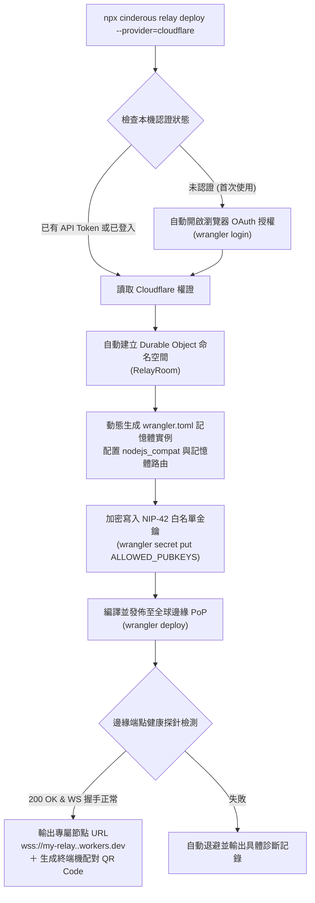

#### 3. 自動生成的 `wrangler.toml` 內部拓撲標準

在部署過程中，SDK 自動為用戶封裝最佳實踐之 Worker 配置，無需手動編寫：

```toml
name = "cinderous-relay"
main = "node_modules/@cinderous/relay-serverless/dist/index.js"
compatibility_date = "2026-09-01"
compatibility_flags = ["nodejs_compat"]

[durable_objects]
bindings = [
  { name = "RELAY_ROOM", class_name = "RelayRoom" }
]

[[migrations]]
tag = "v1"
new_sqlite_classes = ["RelayRoom"]

[observability]
enabled = true
```

#### 4. 程式化部署 API（SDK Programmatic Integration）

> **實作現況（SDK ADR 0008、0021）**：下方範例的套件名稱是規劃期的寫法。實際有兩條路徑：
> - `@cinderous/client/deploy` 的 `deployCloudflareRelay`：Node／CLI 用，交給 wrangler 部署。
> - `@cinderous/client/deploy/cloudflare-api` 的 `deployCloudflareRelayViaApi`：外掛（Obsidian 桌面與行動版）用，直接呼叫 Cloudflare REST API，不需要 Node；授權預設是開瀏覽器到預填權限的 API Token 建立頁；應用若自己註冊了 Cloudflare 的 public OAuth client，也可改走 PKCE。HTTP 由呼叫端注入。用法見 README。
> - 給終端使用者的 Token 建立步驟與依錯誤分類的疑難排解，由 SDK 以資料匯出（`CLOUDFLARE_TOKEN_SETUP_GUIDE`，SDK ADR 0022），外掛設定頁直接渲染；人讀版本見 `docs/guides/cloudflare-api-token.md`。
> - 設定檔驅動（SDK ADR 0050，v0.38）：所有選擇放在 `cinderous.config.json`，`cinderous relay build` 產生可攜的部署包與中英部署說明，`relay deploy --config` 以同一份部署；設定、驗證與產生器在不碰 Node 的 `@cinderous/client/deploy/config`。
> - 私人路徑模式（SDK ADR 0051，v0.41）：個人專屬中繼可改為「開放寫入＋不可猜的隨機路徑」——`privateLane`（`generatePrivateLaneId`，130 位元）讓中繼只接受 `wss://<host>/app/<id>`（`LANES_ONLY`），白名單改為選用；網址等同密碼，外洩時換路徑重新部署。
> - 換路徑的唯讀寬限期與搬家通知（SDK ADR 0052，v0.42）：重新部署時舊路徑進入唯讀寬限期（`retireLane`，預設 7 天、可選 1–30；中繼 `READONLY_LANES`，到期前可讀不可寫、到期後與認不得的路徑相同），應用以 `./pairing` 的 `announceRelayMove` 把新網址以名單加密送給目前的成員（被移除的裝置收不到），收方只替換清單裡已有的舊網址、新網址測得通才換。
> - 部署進度與檢查的雙語（SDK ADR 0055，v0.43）：REST 部署的進度帶穩定的子步驟 id（`substep`）與 `{ zh-TW, en }` 訊息，`collectCloudflareApiDeployIssues` 在部署前一次列出 Worker 名稱、子網域、相容日期、`retireLane` 與站台參數的雙語問題；Vault 同步另補 CinderSync 的協調器缺口（直連進度、各裝置接收狀態、退避重設、補送速率可調、副本檔名解析；SDK ADR 0053）與只讀中繼 `readUrls`（SDK ADR 0054）。
> - 大檔串流寫入的內容校驗（SDK ADR 0057，v0.44）：協調器交給 `writeStream` 的來源帶已校驗過的內容 SHA-256（`sha256`），應用的轉接器寫暫存檔時增量比對、不符就不取代（CinderSync G22）。
> - 備援中繼清單經名單共享（SDK ADR 0056，v0.45，使用者裁示「甲」）：每台在名單上自己簽一份備援清單（`declareStandby`），收方只得到「建議新增」（`StandbySuggestions`：只新增、公開的 `wss://`、不收本機／私有網段、測得通、使用者確認才加入、忽略的記住；移除不共享）；配對的歡迎訊息帶邀請方的備援作為建議（CinderSync G11 第 1 部分）。輕量「已收到」回報（ADR 0053 §G17(b)）使用者裁示 B0、不做。
> - 輕量成員（SDK ADR 0058，v0.46，使用者 2026-10-05 裁示）：Vault 的完整成員（握有全部金鑰）可以只保存部分檔案的內容——協調器的內容範圍（規則／釘選／快取、允許新增的範圍），範圍外只有版本資訊（`remoteIndex` 列得出整棵樹）、按需 `fetch`、LRU 快取（預設 200 MiB）、`evict` 清掉本機副本不產生刪除版本；名單 `declareSparse` 宣告範圍，完整成員送給它時**依收件人裁剪**內容（裁示甲）；完整成員可在排程模式兩輪之間只回應索取（`VaultWantResponder`）。給之後的手機 App 與 CinderSync 用。v0.46.1（SDK ADR 0060，CinderSync G23）：清掉本機副本時交給應用的 `remove` 帶 `evict`（原因 `scope`／`lru`／`evict`；轉接器是 `remove` 的第三個參數），應用可直接刪檔、不備份不進垃圾桶；真正的刪除不變。
> - Markdown 合併規則（SDK ADR 0059，v0.46，裁示 5、7）：兩台各自新建的同路徑文字檔收成一個、以空檔為祖先三方合併（合不了才 callout／副本），任務勾選框衝突自動合併（已勾的贏）；名單上所有成員都宣告支援才打開，合併時由版本 id 的標記決定，每台一致。
> - 版本歷史只在 client 端（SDK ADR 0063，v0.49，使用者 2026-10-08 裁示）：中繼不變；協調器在本機歸檔每個版本（與版本圖分開、文字檔內容以雜湊去重、二進位檔只留版本資訊、不同步），保留 30 天／每檔 100 版／1 GiB 並稀疏化（1 小時全留、1 天每小時、之後每天），輕量成員預設關；列出、讀取、還原（新的本機修改，不改寫歷史）、最近刪除的檔案；整個 Vault 回到時間點（預覽後逐檔以新版本執行）；參考 git 的檢查點（自動最多每小時一個、命名的最多 50 個且內容釘住）、還原之前的檢查點與操作紀錄（可以復原一次還原）。給 CinderSync 的檔案歷史、最近刪除與整庫還原用。
> - 版本歷史 v0.50（SDK ADR 0063〈待決〉三題，使用者 2026-10-08 裁示）：歸檔的版本資訊用到時才載入（啟動時只讀每檔摘要，完整紀錄第一次用到才讀、LRU 快取；整庫的時間點、稀疏化、容量逐檔進行；v0.49 的格式啟動時遷移一次；2 萬檔 × 50 版的啟動由數秒、約 400 MiB 降到 0.5 秒內、約 11 MiB），`history`／`vaultAt`／`planRestoreVault` 改為非同步；整庫還原可另外勾選刪除 T 之後建立的二進位檔（`removeCreatedBinaries`，標不可復原、附總大小，刪除前交給應用備份）；「還原之前」的檢查點跟著保留天數過期，操作紀錄保留但標成不能復原。
> - 收件確認後提早過期 v0.51（SDK ADR 0067，使用者 2026-10-11 裁示）：收件裝置處理完、存好之後以瞬時 kind 25190 告訴中繼，中繼把寄給它一人的那幾列降為「現在＋2 小時」到期（比照未註冊應用的保存期），確認本身不存不轉發；NIP-11 宣告 `cinder_inbox_ack`，客戶端只送給宣告了的中繼。中繼要重新部署才生效。整個收件匣讀過還收不齊的訊框（缺的被淘汰、或寄件端換新 id 重送）也確認掉，不再每次連上重複下載（SDK ADR 0081）。名單同步可以共用傳輸層的 1060 訂閱（傳輸層 `onOtherEvent`＋`NostrRosterSync({ subscribe: false })`，SDK ADR 0082）。
> - 裝置改名 v0.52（SDK ADR 0069，使用者 2026-10-12 裁示）：裝置帶時間在名單上重新簽自己的名稱（`declareLabel`），較晚的蓋過，經名單同步傳到每一台；舊版略過、照舊顯示配對時的名稱。協調器 `setDeviceLabel` 讓之後的版本與衝突副本用新名稱。
> - v0.53（SDK ADR 0070、0071，使用者 2026-10-12 裁示）：把檔案搬進這台排除的範圍只停止追蹤、不是刪除（其他裝置保留；移除排除或搬回來＝改名並合併；移到垃圾桶要由應用通知刪除）；整庫還原的預覽多一份 `keep`（之後建立、這次留著的檔案）。
> - v0.54（SDK ADR 0068，使用者 2026-10-11 裁示 D 方案、2026-10-12 補充）：送出端的中繼預算按收件人記帳，收件裝置處理完回加密簽收單扣帳（只送給寄件人，中繼看不到內容）；某一台帳滿只暫停送給它的份；簽收單也讓寄件端知道對方已收到哪些版本。不需要中繼支援；舊版裝置照舊只會過期。
> - v0.55（SDK ADR 0072，使用者 2026-10-12 裁示）：自動檢查點可以由應用決定時機（`autoCheckpoint: 'app'`＋`checkpoint({ auto: true, minIntervalMs })`），CinderSync 用來讓檢查點跟著同步頻率；預設行為不變。
> - v0.55.1（SDK ADR 0073，技術債）：只差大小寫的兩個路徑在重新納入時不再被誤刪；相撞的同內容檔案只在內容來源版本時收斂（修掉一個罕見的資料遺失）；中繼帳獨立保存（修掉 v0.54 起大量同步的平方級變慢）；一台離線時其他台的批次補送不再被它擋住（量測：7.1 天 → 3 小時）；送出端預算的量測。
> - v0.56.0（SDK ADR 0074）：過時的摘要不再觸發重送——重新上線、新裝置加入、重新啟動時，已經在中繼上的版本不再被送第二次（量測 37–50％ → 0％）；`resync({ lost: false })` 用於只是對帳的情況，預設照舊。另修（SDK ADR 0075）：傳輸層在協調器註冊監聽之前收到的訊息不再丟掉——重新開啟的裝置直接從中繼收到關掉期間的修改，不必等別台重送。
> - v0.57.0（SDK ADR 0076、0077、0078，使用者 2026-10-13「三個 bug 都修」）：認證前被應用車道以 `restricted:` 擋下的 REQ，客戶端在收過挑戰、還沒認證完時當成等認證、認證後重送，SDK 中繼改回 `auth-required:`——剛連上的第一個查詢不再固定浪費；一次性查詢的逾時改以「多久沒有新資料」計（最長 12 倍）——收件匣有大量檔案塊時分頁補拉不再每次在 5 秒切斷、每輪都「沒有中繼回完」；耐久度發布加 `standbyWhenDisconnected`——排程連線的應用可以讓「主要中繼只是沒連線」時不改用備援，兩輪之間的名單變動不再只落在備援上。
> - v0.57.1（SDK ADR 0079、0080，使用者 2026-10-13「全都修正」）：`history()` 的版本加 `absorbed`——兩台各自建了同一篇、被收進另一個檔案的那份刪除版本，應用可以顯示成「已合併」而不是「已刪除、0 B」；剛連上時的補拉不再逾時——一次性查詢等某座回完時，那一座還在傳任何資料（例如常駐訂閱往回拉的一大段）就不算閒置；傳輸層 `start()` 時沒連上就不補拉。
> - v0.58.0（SDK ADR 0081、0082，使用者 2026-10-14「依序處理」）：整個收件匣讀過還收不齊的訊框也送收件確認（不再每次連上重複下載；CinderSync 手機實測 827 則、約 104 MB）；傳輸層 `onOtherEvent` ＋ `NostrRosterSync({ subscribe: false })`，名單同步共用 1060 訂閱（中繼不再把同一批檔案塊回兩次）。
> - v0.58.1（SDK ADR 0083，使用者 2026-10-14「依序處理」）：中繼的「空 content＝清除」只限快照 kind 30078；NIP-17 10050、NIP-65 10002、NIP-02 kind 3 依規格 content 為空，過去回 `OK true` 卻被刪掉，現在照常保存、查得到（Cinderous ADR-0382 §7）。中繼要重新部署才生效。
> - v0.59.0（SDK ADR 0049 C′ R1，使用者 2026-10-14「sdk 的部署設定器與 iot 可以繼續實作」）：IoT 即時通道的 relay 端——設備常駐 `wss`、命令立刻推送；relay 只持有閘道金鑰與設備權杖雜湊，指令與狀態裝在 AES-256-GCM 設備信封裡（`./iot` 新增 `sealIotEnvelope`／`openIotEnvelope`、設備幀與權杖）。轉送半依簽章者角色授權、設備離線立刻回 `offline`；每個家庭的每日預算 80% 預警、95% 分流、100% 以 4429 關閉並回結構化 503。Workers 是獨立 DO 類別 `IotHomeRoom`（綁定 `IOT_HOME`），Node 用同一份核心；沒設定 `IOT_REALTIME` 就完全不開。`RelayCore` 新增 `intercept` 與 `publishLocal`（沒設定時行為不變）。手機端 API、`./iot/device`、NIP-11 與設定器接線在 R2；尚未部署到 Cloudflare 實測。
> - v0.60.0（SDK ADR 0084、0085，使用者 2026-10-14「客戶端修法和整批淘汰都做，先 SDK 再移植」）：傳輸層每次啟動（有中繼宣告收件確認時）先從頭補拉一次收件匣，讓一直續讀的裝置也會確認永遠收不齊的訊框；中繼淘汰檔案塊時同收件人、同 `expiration` 標籤的整批一起刪（FIFO、天花板、保底份額外、借用到期），不再切出孤兒。SQLite 新增可為 NULL 的 `batch` 欄與部分索引（相容遷移）。中繼要重新部署才生效；外掛要升級才有客戶端修法。

除了 CLI 之外，SDK 本身亦將 Cloudflare 部署封裝為非同步函數，供第三方桌面外掛（例如 CinderSync 在 Obsidian 設定頁面點擊按鈕直接調用）或自動化腳本使用：

```typescript
import { deployCloudflareRelay } from '@cinderous/relay-serverless/deploy';

// 支援在 Obsidian 外掛或 Node.js 腳本中一鍵開通
const deployment = await deployCloudflareRelay({
  workerName: 'my-obsidian-vault-relay',
  allowedPubkeys: [myLocalNostrPubkey],
  apiToken: userProvidedToken,
  onProgress: (status) => console.log(`[佈署進度]: ${status.message}`)
});

console.log('專屬中繼站開通完畢：', deployment.relayEndpoint);
// 輸出：wss://my-obsidian-vault-relay.user.workers.dev
```

---

### 5.4 資源消耗與營運成本試算引擎規範 (Resource Consumption & Cost Estimator Engine)

在去中心化與本地優先架構中，開發者在「密碼引擎選型（Cinder EK vs 雙棘輪）」、「後量子混合防禦開關」與「傳輸層拓撲」之間決策時，最常遭遇的障礙是**「無法預先量化資源消耗」**。

為賦予開發者完全透明的決策能見度，`Cinderous SDK` 原生內建**資源消耗與營運成本試算引擎（`@cinderous/client/estimator`）**，並無縫整合至 CLI（`npx cinderous estimate`），支援在寫代碼前以具體業務參數秒級模擬精算。

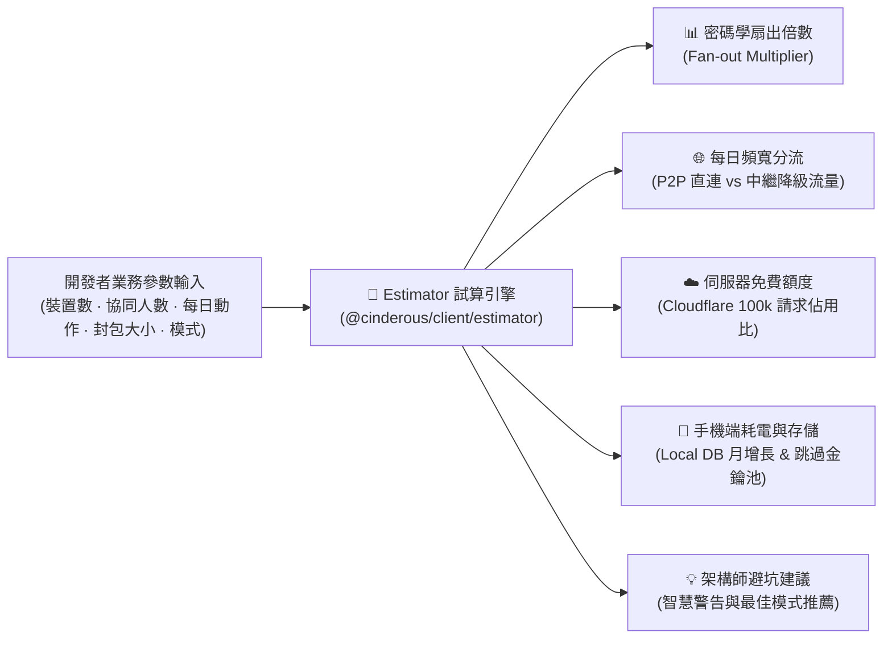

#### 1. 核心精算數學模型（Actuarial Formulas）

試算引擎遵循底層真實物理運作之精確公式：

- **每日事件生成量（Daily Events, $E$）**：
  - **Cinder EK 模式**（$O(1)$ 負載）：
    $$E_{\text{daily}} = N_{\text{actions}} \times 2 \quad \text{（自封副本 ＋ 遠端封裝）}$$
  - **雙棘輪 Sesame 模式**（$O(N)$ 扇出）：
    $$E_{\text{daily}} = N_{\text{actions}} \times \Big( (M - 1) \cdot D_{\text{remote}} + (D_{\text{self}} - 1) \Big)$$
    *其中 $N_{\text{actions}}$ 為每日操作數，$M$ 為群組人數，$D_{\text{remote}}$ 為對方裝置數，$D_{\text{self}}$ 為自己裝置數。*
- **線路封包開銷（Wire Overhead, $S_{\text{wire}}$）**：
  - 古典 NIP-44：基礎開銷 $\approx 80 \text{ Bytes}$（Nonce + MAC + 8倍數填補）。
  - 後量子 ML-KEM-768 模式：
    - Cinder EK：$1,088 \text{ Bytes}$ 密文僅在每週金鑰公告或快照時分攤，每則常態開銷無感。
    - 雙棘輪（SPQR）：每次 DH 棘輪步進增加 $1,184 \text{B (PK)} + 1,088 \text{B (CT)} \approx 2,272 \text{ Bytes}$。
- **中繼伺服器每日負載（Relay Ingestion Volume）**：
  $$B_{\text{relay}} = E_{\text{daily}} \times (1 - R_{\text{p2p}}) \times (S_{\text{payload}} + S_{\text{wire}})$$
  *其中 $R_{\text{p2p}}$ 為預估 WebRTC 打洞成功率（預設 85%，15% 為對稱型 NAT 降級走 Relay）。*
- **Cloudflare 免費層消耗佔比**：
  $$\text{CF\_Usage\%} = \frac{E_{\text{daily}}}{100,000} \times 100\%$$

#### 2. TypeScript 介面定義 (`@cinderous/client/estimator`)

```typescript
export interface ConsumptionSimulationInput {
  /** 密碼引擎模式 */
  cryptoMode: 'cinder-ek' | 'double-ratchet';
  /** 是否開啟後量子混合防禦 (ML-KEM-768) */
  postQuantum: boolean;
  /** 使用者擁有的個人裝置總數 (預設 3 台) */
  devicesCount: number;
  /** 協同對象數量 (1:1 設 1，群組協同設成員數，如 15) */
  collaboratorsCount: number;
  /** 預估每日同步/編輯動作次數 (如 300 次) */
  dailyActionsCount: number;
  /** 平均單次編輯資料量 Bytes (如筆記差分 15KB，附件 500KB) */
  averagePayloadBytes: number;
  /** 預估 WebRTC P2P 打洞成功率 (預設 0.85，受限網絡設 0) */
  p2pSuccessRate?: number;
  /** 目標部署環境 (預設 'tier-2-serverless') */
  targetTier?: 'tier-0-public' | 'tier-1-selfhosted' | 'tier-2-serverless';
}

export interface ResourceEstimationReport {
  readonly crypto: {
    readonly fanoutMultiplier: number;
    readonly dailyTotalEvents: number;
    readonly wireOverheadPerMessageBytes: number;
  };
  readonly network: {
    readonly dailyP2PVolumeBytes: number;
    readonly dailyRelayVolumeBytes: number;
    readonly monthlyRelayBandwidthMB: number;
  };
  readonly infrastructure: {
    readonly cloudflareDailyRequests: number;
    readonly cloudflareFreeTierUsagePercent: number;
    readonly isExceedingFreeTier: boolean;
    readonly estimatedMonthlyCostUSD: number;
  };
  readonly device: {
    readonly monthlyLocalStorageGrowthMB: number;
    readonly batteryDrainProfile: 'negligible' | 'low' | 'moderate' | 'heavy';
    readonly skippedKeysMemoryCacheKB: number;
  };
  readonly architecturalAdvice: string[];
}

export function estimateResourceConsumption(
  input: ConsumptionSimulationInput
): ResourceEstimationReport;
```

#### 3. CLI 互動式命令列與報告產出

終端機開發者可直接執行：

```bash
# 試算 15 人協同在雙棘輪模式下的資源消耗
npx cinderous estimate \
  --mode=double-ratchet \
  --pq=true \
  --devices=5 \
  --collaborators=15 \
  --daily-actions=500 \
  --payload-kb=20
```

**終端機產出範例**：
```
================================================================================
                    Cinderous SDK 資源與營運成本試算報告
================================================================================
[情境配置]: 雙棘輪 (PQ-Double Ratchet) | 15 位協同者 | 5 台本機裝置 | 每日 500 次動作 (20 KB)
--------------------------------------------------------------------------------
📊 密碼學與扇出開銷 (Cryptographic Fan-out):
  • 扇出乘數 (Multiplier):           74.0x (每送 1 則訊息需產生 74 份事件)
  • 每日事件產生總數:                 37,000 events / 天
  • 單則線路額外包裝開銷:              2,352 Bytes (含 ML-KEM-768 棘輪步進)

🌐 網路頻寬預估 (Network Bandwidth):
  • P2P 直連每日流量 (85% 成功率):     629.0 MB / 天 (0 伺服器頻寬)
  • Relay 中繼每日流量 (15% 降級):     123.8 MB / 天
  • 每月中繼流量總計:                  3.71 GB / 月

☁️ 基礎設施健康度 (Cloudflare Workers Tier 2):
  • 每日請求調度數:                   37,000 / 100,000 requests
  • 免費層額度佔用率:                  37.0% (安全綠燈，未穿透免費層)
  • 預估雲端運維費用:                  $0.00 USD / 月

🔋 終端裝置健康度 (Device Health):
  • 本機儲存月增長 (Local DB):        29.3 MB / 月
  • 跳過金鑰緩衝記憶體 (MKSKIPPED):   ~480 KB (安全範圍)
  • 行動端耗電評級:                   [MODERATE] 中度耗電 (高頻棘輪 KDF 運算)

💡 架構師最佳化建議 (Architectural Advice):
  [!] 檢測到協同人數達 15 人且啟用雙棘輪，扇出倍數高達 74 倍。
      若此場景為「個人筆記庫多端同步 (CinderSync)」，強烈建議將 mode 改為
      'cinder-ek'，事件數將由 37,000 驟降至 1,000 (削減 97.3%)，耗電轉為 NEGLIGIBLE。
================================================================================
```

---

## 陸、資安威脅建模、成本估算與未來演進 (Security, Cost, & Roadmap)

### 6.1 STRIDE 資安威脅防禦矩陣

| 威脅分類 | 潛在攻擊途徑 | `cinderous-relay` 防禦措施 |
| :--- | :--- | :--- |
| **Spoofing (冒充)** | 惡意第三方冒充合法節點發送假 SDP | **NIP-42 雙向簽名驗證**：未持有合法 Nostr 私鑰者在 WebSocket 握手時即遭阻斷。 |
| **Tampering (篡改)** | 惡意中繼篡改 WebRTC 候選地址 | **端對端簽名與外覆封裝**：SDP 內容皆有原始發起者之 Schnorr 簽名，中繼篡改將導致驗簽失效。 |
| **Repudiation (否認)** | 拒絕承認發起過協同連線 | **事件唯一 ID 與時間戳記**：每筆信令包含不可否認之 SHA-256 雜湊與時間序列。 |
| **Information Disclosure (洩密)**| Relay 運維者刺探檔案內容或文字 | **端對端加密**：有效載荷在裝置上加密（NIP-44／59，可選 ML-KEM-768 混合），Relay 只見密文；IP、時間、大小、收件人 pubkey 等中繼資料仍可見，見 ADR 0064。 |
| **Denial of Service (阻斷服務)**| 外部腳本灌入海量連線癱瘓記憶體 | **白名單硬性閘門 ＋ 令牌桶限流**：非白名單公鑰連 1 Byte 訊息都發不出去。 |
| **Elevation of Privilege (越權)**| 嘗試透過 WebSocket 注入惡意指令 | **純資料管道**：Relay 不執行任何動態代碼或 SQL 拼接，記憶體處理邏輯為純確定性狀態機。 |

---

### 6.2 營運與頻寬成本精算（Cost Model）

以一位重度 Obsidian 使用者每天編輯 8 小時、同步 500 次為例：
- **每次打洞信令傳輸量**：約 $1.5 \text{ KB}$（SDP Offer + Answer + ICE）。
- **單日信令總流量**：$500 \times 1.5 \text{ KB} = 750 \text{ KB}$（不足 1 MB）。
- **後續檔案/打字同步流量**：全部走 WebRTC P2P 直連，**消耗 Relay 頻寬為 0 MB**。
- **Cloudflare 免費層額度**：每日 100,000 次請求。
- **額度消耗比**：$500 / 100,000 = 0.5\%$。
- **結論**：單一用戶或 10 人以內小團隊，**永久維持 $0 美元維運費用**。

---

### 6.3 未來演進路線圖 (Future Roadmap)

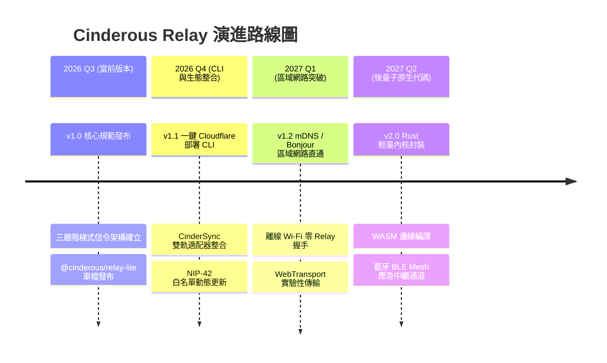

---

## 柒、規格簽核與發行資訊

- **維護者**：VaalRL
- **發行日期**：2026 年 09 月 21 日（民國 115 年）
- **關聯文檔與旗艦外掛代碼庫**：
  - CinderSync Obsidian 外掛、Cinder Coffice 即時協同工作區：規格書在各自的外掛 repo，目前還沒公開
